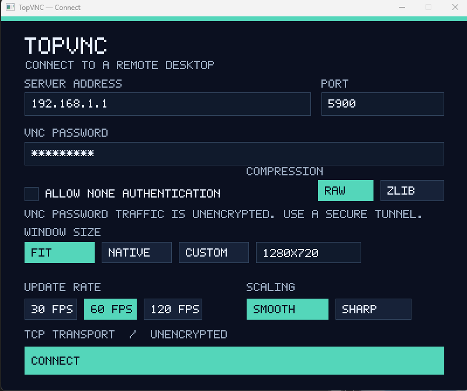
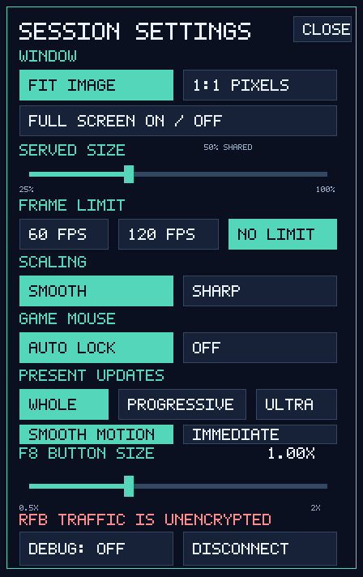
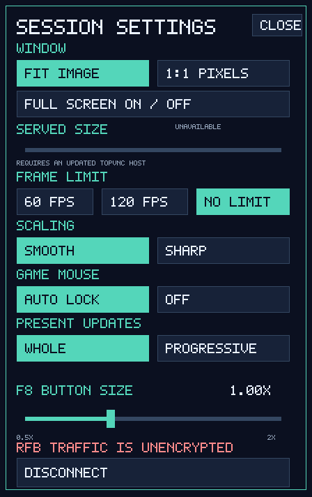

# TopVNC

A VNC viewer written in Rust, built toward responsive remote gaming with low input latency and smooth frame presentation.

TopVNC can also serve a Windows or macOS display over RFB 3.8. The reusable server protocol is in the library; the Windows and macOS executables capture the desktop and inject remote keyboard and mouse input. Linux hosting is not implemented yet. See [`specs/004-vnc-server/spec.md`](specs/004-vnc-server/spec.md) for protocol and Windows limits, and [`specs/005-macos-server/spec.md`](specs/005-macos-server/spec.md) for the macOS host.



*TopVNC running on Windows, with connection and display settings in one window.*

**Early development:**

- **Viewer.** It was tested on Windows against a live macOS VNC server and on macOS against a live server on the local network, both before the 0.3 window rewrite. The rewritten viewer (winit and wgpu) has been run live on macOS against TopVNC's server, including pointer lock and the side buttons. The newer render worker has passed a synthetic Windows GPU test with 1080p uploads on a 240 Hz monitor; its live Windows-to-Mac gaming behavior remains unverified. The Linux build is untested.
- **Windows server mode.** It compiles and links, and its platform-neutral logic is tested, but live desktop capture and input injection have not been verified (an earlier attempt outside an interactive desktop was denied with `0x80070005`).
- **macOS server mode.** It has served a live display, and relative mouse motion from a viewer moved the Mac's pointer. Full remote control and unlocking are still under validation.
- Linux hosting is not implemented.
- **Measurements.** Frame rate and latency have been measured end to end between TopVNC's own server and viewer over an emulated network link ([Performance](#performance)), not yet with live capture of a game.

[Quick start](#quick-start) · [Controls](#controls-and-display-settings) · [Security](#security-and-saved-settings) · [Development](#development) · [Roadmap](#roadmap)

## Features

- **Native connection UI** with a masked password field, input validation, and connection errors shown in the window.
- **Tight encoding with JPEG** (the default), plus Raw and Zlib, with 32-bit true color and incremental framebuffer updates. Full-screen motion such as games fits in a fraction of Raw's bandwidth; see [Performance](#performance).
- **Pushed updates** (RFB ContinuousUpdates with Fence flow control): the server sends each new frame without waiting for a request, keeping at most a few frames in flight from the measured throughput. Servers without them get adaptive request pipelining.
- **Mouse look for games.**
  - When the host hides its cursor, as games do while you aim, the viewer locks and hides its pointer and sends raw relative motion, so the camera turns freely. This uses the QEMU Pointer Motion Change extension.
  - **F8** or switching to another app releases the pointer.
  - The back and forward side buttons reach the host too (ExtendedMouseButtons).
- **Coherent GPU presentation** with winit and wgpu. A dedicated render worker selects the latest complete frame, scales it on the GPU, and uses synchronized Smooth motion by default. Input is sent as the system delivers it, independently of GPU and vsync waits.
- **Parallel encoding and decoding.** The server encodes a frame in bands on every core and sends each band as soon as it is ready. The viewer decodes JPEG bands in parallel.
- **Keyboard and mouse input** for interacting with the remote desktop. Keys are sent by their position on a US keyboard, as games expect.
- **Adjustable display** with fit-to-window or native pixels, smooth or sharp scaling, full screen, and 60 FPS, 120 FPS, or no presentation limit.
- **In-session settings** accessible through **F8**, including live served-size and host-display requests to updated TopVNC hosts, disconnect, and a resizable on-screen settings button.
- **Multiple host displays** on Windows hosts: serve the primary display, a chosen one, or all of them side by side, switch between them from the viewer, and follow monitors that are unplugged, plugged in, or made primary.
- **Saved connection details** with platform-specific password storage.
- **Experimental Windows and macOS server modes**, started from the app's Server tab or with `--serve`, with display capture, resolution-change handling, remote keyboard/mouse input, clipboard sync, and password authentication; live validation is pending.
- **Windows helper tabs** for the work-server launcher, read-only network diagnostics, and scoped firewall preview, set, and reset actions, with paged reports and copyable commands.

The protocol implementation handles RFB 3.3, 3.7, and 3.8. Apple's `RFB 003.889` banner is handled through a standard RFB 3.8 fallback; Apple-specific authentication is not implemented.

## Quick start

You need a stable Rust toolchain with Cargo and native build tools for your platform. Windows and macOS are the currently tested client platforms. To connect, you also need a reachable VNC server configured for standard VNC password authentication.

```sh
git clone https://github.com/yutigi/TopVNC.git
cd TopVNC
cargo run --release
```

1. Enter the server address and port (usually `5900`). Use brackets around IPv6 addresses, such as `[::1]`.
2. Enter the server's VNC password.
3. Choose the compression, the initial window size, presentation rate, and scaling mode. For games and video, pick a **Tight JPEG** quality: **Low** (level 3) for Wi-Fi or slow links, **Med** (level 6, the default), or **High** (level 9) for a fast wired link. **Raw** and **Zlib** are lossless but far larger.
4. Click **Connect**. Press **F8** during the session to adjust display settings or disconnect.

> **Transport security:** TopVNC currently uses unencrypted TCP. VNC password authentication does not encrypt the framebuffer or input traffic. Use an isolated network or a separately secured tunnel for sensitive sessions. See [Security and saved settings](#security-and-saved-settings).

### Command-line options

Arguments prefill the connection form; they do not bypass it.

```sh
cargo run --release -- 127.0.0.1:5900
cargo run --release -- 127.0.0.1:5900 --window 1280x720
```

| Argument | Effect |
| --- | --- |
| `HOST:PORT` | Prefill the server address and port. |
| `--fit` | Fit the remote image to the viewer window. |
| `--native-size` | Show native pixels; center and crop if the image is larger than the window. |
| `--window WIDTHxHEIGHT` | Set a custom initial window size, such as `1280x720`. |
| `--allow-insecure` | Explicitly allow a server offering unauthenticated `None` security. |
| `--quality LEVEL` | JPEG quality level for Tight, from 0 (smallest) to 9 (best); default 6. Lower it on a slow link. The form shows the level and offers 3, 6, and 9 as presets. |
| `--ultra` | Enable Ultra performance mode: keep complete images coherent and remove the local FPS cap. Also selectable in the connection form and F8 panel. |
| `--smooth-motion` | Synchronize presentation to the display, preferring Mailbox and otherwise Fifo; default. |
| `--immediate` | Present without waiting for vertical sync where supported; may tear. |
| `--input-debug` | Log outgoing key and pointer events for troubleshooting. |

Do not use `--input-debug` while typing passwords: it logs key events.

### Serve this desktop

Open the **Server** tab in the TopVNC window, enter a password, and click **Start server**. The tab binds to `127.0.0.1:5900` by default; click **All networks** to listen on every interface. Click **Display** to choose what to share: each click moves to the next choice, from **MAIN** (the primary display) to each detected display with its pixel size, then **ALL** displays side by side on Windows. **Served size** scales the image viewers receive, from 0.25× to 1.00× of the display's pixel size: drag the slider, or click **Full** or **Half**. Half size serves a Retina display at its size in points, a quarter of the pixels, which cuts encoding time and bandwidth for games. **Game mouse** chooses when viewers are asked for relative mouse motion, as `--mouse` does below: **Auto**, **Relative**, or **Absolute**. The tab shows the served size, address, and number of connected viewers, and keeps running while you use TopVNC as a viewer. Closing TopVNC stops the server. Server settings and passwords are not saved.

You can also run the server as a separate console mode. It binds to localhost by default and prompts for a VNC password:

```sh
cargo run --release -- --serve
cargo run --release -- --serve 0.0.0.0:5900
cargo run --release -- --serve 0.0.0.0:5900 --display 2
cargo run --release -- --serve 0.0.0.0:5900 --display all
cargo run --release -- --serve 0.0.0.0:5900 --scale 0.5
cargo run --release -- --serve 0.0.0.0:5900 --mouse relative
```

The second and later commands listen on all network interfaces, and `--scale` sets the served size (0.25 to 1). `--mouse` chooses when the server asks viewers for relative mouse motion:

- `auto`, the default, asks while a Windows host's cursor stays hidden, as it is while a game turns the camera.
- `relative` always asks, for games the automatic mode misses and for Mac hosts, which cannot tell when a game hides the cursor. The viewer's pointer then stays locked for the whole session.
- `absolute` never asks.

**Update priority** (choose before starting the server) controls which pending pixels are transmitted first:

| Server tab / CLI | Behavior |
| --- | --- |
| Whole / `--priority whole` | Existing whole-screen order; default. |
| Center / `--priority center` | Tiles nearest the screen center first. |
| Mouse / `--priority mouse` | Tiles nearest that viewer's last pointer position first; center before pointer input and during relative mouse look. |
| Changes / `--priority changes` | Most recently modified tiles first. |

All modes send every requested dirty region, including background areas. Priority applies to TopVNC's built-in server and works with Raw and Tight; it does not configure a third-party VNC server. Focus modes use smaller rectangles, so compression and bandwidth can differ. No latency improvement has been measured yet.

In the viewer, **F8 → Present updates → Whole** (the default) and **Ultra** wait for a complete framebuffer update. **Progressive** explicitly permits partial images: it publishes the first decoded region immediately, batches subsequent regions at intervals of at least 8 ms, and publishes remaining changes at update completion. Those snapshots still follow the selected presentation policy and frame limit. Progressive can make camera motion look discontinuous; choose Whole or Ultra for coherent gaming images. `--progressive` remains available for experimenting with prioritized regions.

**Ultra performance mode** now hands off complete images and presents without an additional local FPS cap. Earlier Ultra versions displayed individual bands; that policy has been replaced because fast camera movement could show parts of different frames. Choose **ULTRA: ON** in the connection form or **F8 → Present updates → Ultra**, or run:

```sh
cargo run --release -- HOST:5900 --ultra --smooth-motion
cargo run --release -- --serve --ultra
```

The Server tab has its own **ULTRA: ON** choice, set before starting the host. Server Ultra flushes each encoded Tight band immediately and honors future pacing deadlines below 1 ms without deliberately rounding them up to 1 ms. The viewer's mode works with other servers too, but cannot change their capture or encoding behavior. Both ends retain normal authentication and flow control. Encoding, JPEG quality, and served resolution remain explicit choices.

Keep **F8 → Smooth motion** selected for synchronized presentation. It uses Mailbox when the surface advertises it, otherwise Fifo (the Metal path); **Immediate** allows tearing where supported. GPU waits run on a separate thread so they do not block input. Ultra can increase GPU submissions, socket writes, CPU use, and bandwidth; it does not disable Smooth motion. Idle sessions still wait for events. Toggle Ultra off to restore the previous presentation cap and Whole/Progressive policy; choosing 60/120 FPS or Whole/Progressive also exits Ultra. These settings are not saved between launches.

The decoder and renderer communicate through one pending image and two reusable CPU snapshot buffers. Newer complete frames replace unread ones and retain all changed areas, so a slow or occluded viewer does not accumulate stale frames. Buffer reuse copies changed/stale regions, rather than copying the entire image for every rectangle. Only the render worker writes the image texture. It acquires a display drawable before selecting the newest snapshot, so a vsync wait does not age an already selected frame. Raw server updates also snapshot changed pixels before transmission, preventing later capture rows from leaking into the current update.

**Below 0.5 ms input-to-screen is an unachieved target.** Ultra does not guarantee it. Capture waits for an available desktop image, and GPU presentation can still depend on the driver and compositor. See [Microsoft's capture API](https://learn.microsoft.com/en-us/windows/win32/api/dxgi1_2/nf-dxgi1_2-idxgioutputduplication-acquirenextframe) and [wgpu's presentation modes](https://docs.rs/wgpu/30.0.0/wgpu/enum.PresentMode.html). Physical input-to-visible-response requires measurement with real capture and display hardware.

The Server tab's **Game mouse** buttons set the same three modes, starting at Auto. Standard VNC password authentication uses only the first eight password bytes. TCP is unencrypted, so use a trusted network or a secure tunnel. To intentionally disable authentication, add `--allow-insecure`; do this only on an isolated trusted network. Clipboard text is synchronized between remote clients and the Windows system clipboard; characters outside Latin-1 are replaced with `?` when sent to viewers.

The server shares the primary display unless `--display NUMBER` selects another attached display (numbered from 1, as the Server tab lists them) or `--display all` shares every display in one image arranged as on the desktop. On Windows, the server follows display changes within about a second. If another display becomes primary, the primary choice switches to it. If a chosen display is unplugged, the primary display is served until it returns. Plugging in or removing a monitor under **ALL** recomputes the layout. If all displays together exceed VNC's 8192-pixel limit, the primary is served instead, with a notice. Viewers can switch displays during a session with **F8 → Display**; like the served size, the choice is shared by all viewers. To give each display its own port, run one server per display, such as `--serve 0.0.0.0:5900 --display 1` and `--serve 0.0.0.0:5901 --display 2`. See [`specs/013-multi-monitor/spec.md`](specs/013-multi-monitor/spec.md) for what has been validated. Run it in an interactive, unlocked session: services and disconnected Remote Desktop sessions cannot capture the desktop. While Windows shows the secure desktop (UAC prompts, the lock screen), viewers keep the last image and capture resumes automatically afterward. If the display resolution changes, viewers that support the DesktopSize extension follow the new size; others are disconnected and can reconnect. TopVNC's viewer now handles live size changes without reconnecting.

#### On macOS

Hosting a Mac needs macOS 12.3 or later and two permissions, which the Server tab shows while the server is stopped:

- **Screen Recording** (*System Settings → Privacy & Security → Screen & System Audio Recording*) is required. Without it the server asks for access and refuses to start; quit and relaunch after granting it.
- **Accessibility** (*System Settings → Privacy & Security → Accessibility*) lets viewers type and use the mouse. Without it the server runs view-only and shows a warning, and remote input starts as soon as access is granted, without a restart.

When TopVNC runs from a terminal, including `cargo run`, macOS grants both permissions to the terminal app, not to TopVNC. The server shares the main display, following it when another display becomes main, or `--display NUMBER` in ScreenCaptureKit's display order. Serving all displays at once and switching displays from the viewer are not implemented for Mac hosts yet. The display is served at its native pixel size by default: a Retina display is then served at its full pixel resolution, which makes updates large. For games, serve at half size and use Tight JPEG in the viewer. ScreenCaptureKit scales the image on the GPU. The cursor is part of the captured image. If port 5900 is already taken, macOS Screen Sharing or Remote Management may be listening on it; choose another port such as 5901. A Mac that is locked cannot be captured or unlocked through this server: viewers keep the last image, and starting the server while the Mac is locked fails.

## Controls and display settings

| Control or setting | Behavior |
| --- | --- |
| Keyboard and mouse | Send input to the remote desktop, including the back and forward side buttons. |
| Mouse lock | While the host hides its cursor (in a game), the pointer locks and every motion turns the camera. The title bar shows *locked (F8)*. |
| **F8** or **F8 SETTINGS** | Open the in-session settings panel. This also releases a locked pointer, and the on-screen button hides while the pointer is locked. |
| Window edges | Drag to resize the viewer. |
| F8 → Display | Choose which host display to see, numbered as on the host, or **ALL** displays side by side. The highlighted button is what the host serves; the choice is shared by every viewer. Shows *Not offered by this host* for Mac hosts, older TopVNC hosts, and other servers. |
| F8 → Served size | Drag from **25% to 100%** in 1% steps; release to request the size from an updated TopVNC host. |
| Fit / 1:1 pixels | Scale the remote image to the window while preserving its aspect ratio, or show native pixels, centered and cropped when necessary. |
| Full screen | Switch the viewer to full screen and back. |
| 60 FPS / 120 FPS / No limit | Cap local presentation. **No limit**, the default, adds no application FPS cap; Smooth motion still synchronizes to the display. This does not set the server's frame rate. |
| Ultra | Publish complete images without an additional local FPS cap; click again to restore the prior settings. |
| Smooth motion / Immediate | Synchronize presentation to the display, or permit immediate presentation and tearing. Separate from Smooth/Sharp image scaling. |
| Smooth / Sharp | Choose the scaling appearance. |
| Game mouse: Auto lock / Off | **Off** never locks the pointer: the viewer stops offering relative motion and the server sends absolute positions. |
| F8 button size | Adjust the on-screen settings button from 0.5× to 2.0×. |
| F8 → Debug | Toggle **DEBUG: OFF/ON**. Off by default: the title shows a shortened desktop name and rendered FPS. On shows the detailed performance counters. This does not enable input logging. |
| Disconnect | Return to the connection form. |



*Capture of the actual software-rendered F8 panel, generated with `examples/capture_session_ui.rs`; this is a renderer capture, not a live desktop screenshot.*

**Served size** was previously available only before starting the host. Both the viewer and host must run this updated build to change it through F8. The control reduces the pixels encoded and sent in the stream; **Fit image**, **1:1 pixels**, and **Smooth/Sharp** adjust local presentation. It does not change the host's display resolution. The percentage is shared by all viewers, and the last request wins. The slider previews the percentage while dragging and sends one request on release, avoiding capture restarts for every mouse movement. After release it follows the percentage published by the host. Older TopVNC hosts and third-party servers show a disabled served-size slider with **Requires an updated TopVNC host** and receive no scale commands. If the slider is disabled, update and restart the remote TopVNC host, then reconnect. If the entire **Served size** row is missing, restart the viewer using this branch's rebuilt executable. Older viewers without DesktopSize support may disconnect when another viewer changes the shared size.



For a local synthetic preview that captures no desktop, run `cargo run --example served_size_demo`, then open TopVNC, connect to `127.0.0.1:5998` with **Allow insecure** explicitly enabled, choose a `1280x720` window, and open F8. The demo binds only to loopback, discards input, and stops after five minutes. Windows protocol tests cover repeated resize and full refresh with Raw/Tight and requested/pushed updates. macOS capture wiring is implemented but has not been compiled or run here; live desktop capture and GUI click validation remain pending.

The initial viewer fits within the primary display by default when the remote screen is larger. Scaling happens on the GPU at the display's full resolution. The network thread requests updates independently of the presentation limit.

## Performance

Games and video change the whole screen every frame. A Raw 1920×1080 frame is about 8.3 MB, which limits a 1 Gbit/s link to about 15 frames per second. TopVNC's server and client both support Tight encoding:

- Flat areas stay lossless and sharp: single colors are sent as fills, and areas of up to 16 colors as palettes.
- Everything else is sent as JPEG at the viewer's quality level.
- Changed tiles are merged into bands, about one per core, which are encoded in parallel and sent as each finishes. The viewer decodes them in parallel too. At 1920×1080 and quality 6 on an M3 Max:
  - encoding takes 1.9 ms instead of 4.0 ms, and the first band leaves after about 1 ms;
  - decoding takes 0.8 ms instead of 4.2 ms.

Each frame normally waits for the viewer's request, so a Wi-Fi round trip of 10–20 ms caps the frame rate well below 60 even when the link has room. When both ends support ContinuousUpdates and Fence, as TopVNC's server and viewer do, the server pushes frames instead. A fence after each update tells it what the viewer has received, and it paces frames to the throughput it measures, so frames do not queue on a slow link.

Results from `cargo run --release --example latency_bench`, between TopVNC's server and viewer through a local proxy that emulates the link. Latency is from the server receiving a frame until the viewer has all of it. Desktop capture, display, and input are not included.

1920×1080 at 60 fps, 2 ms each way:

| Link | Encoding | Frames per second | Mean latency | Per frame |
| --- | --- | --- | --- | --- |
| 1 Gbit/s | Raw, one request per frame (0.2.0) | 14.0 | 78.4 ms | 8.2 MB |
| 1 Gbit/s | Tight quality 6, pushed | 60.2 | 8.4 ms | 262 KB |
| 1 Gbit/s | Tight quality 3, pushed | 60.2 | 7.3 ms | 97 KB |
| 150 Mbit/s | Tight quality 6, pushed | 53.8 | 27.2 ms | 262 KB |
| 150 Mbit/s | Tight quality 3, pushed | 60.2 | 11.7 ms | 97 KB |

Half-size Retina (1512×982) at 60 fps, 8 ms each way (Wi-Fi-like), against 0.2 in the same session:

| Link | Encoding | 0.2 | Now |
| --- | --- | --- | --- |
| 150 Mbit/s | Tight quality 6, pushed | 58.5 fps, 29.4 ms | 60.2 fps, 24.1 ms |
| 150 Mbit/s | Tight quality 3, pushed | 60.0 fps, 24.2 ms | 60.2 fps, 18.5 ms |
| 300 Mbit/s | Tight quality 6, pushed | 60.2 fps, 23.0 ms | 60.2 fps, 19.7 ms |

The scene is synthetic, so real games compress differently. If a link cannot keep up, lower `--quality`.

For playable results:

- **Use release builds** (`cargo run --release`, or `target/release/topvnc`) on both machines. Debug builds optimize dependencies, but TopVNC's own code runs about 2–3 times slower than in release.
- **Serve a Retina Mac at half size.** A full-size frame from a 14-inch MacBook Pro is about 3.7 times the data of a half-size one. Over a 150 Mbit/s Wi-Fi-like link (4 ms each way):

  | Served size | Frames per second | Mean latency |
  | --- | --- | --- |
  | 3024×1964 (full) | 26.3 | 55.6 ms |
  | 1512×982 (half) | 60.3 | 13.6 ms |
- **Enable F8 → DEBUG: ON for diagnostics.** The title normally shows only the desktop name (shortened to 24 characters plus an ellipsis when needed) and rendered FPS, with a short hint while the mouse is locked. Debug mode adds:
  - decoded FPS, KB per frame, and Mbit/s;
  - the encoding the server sends, and `push` when the server pushes frames;
  - rendered FPS, p95 frame-submission interval, and the selected GPU presentation mode;
  - the mean time from publishing a completed snapshot to submission, labeled **ready to submit**, and the count of **superseded** unread snapshots. These are client-side measurements, excluding input, capture, transport, decode, GPU completion, and scanout.

  If it says Raw, the server does not support Tight; without `push`, every frame waits a round trip.

Tight between TopVNC's server and client is covered by tests. Tight against third-party servers and viewers, and with live desktop capture, has not yet been validated. See [`specs/006-low-latency-gaming/spec.md`](specs/006-low-latency-gaming/spec.md) and [`specs/007-competitive-gaming/spec.md`](specs/007-competitive-gaming/spec.md) for the full measurements.

### Ultra measurements

On Windows with a Ryzen 9 9950X3D, the validated row conversion reduced the **CPU framebuffer application stage** at 1920×1080 from 0.763 ms mean / 0.790 ms p95 to 0.381 ms mean / 0.393 ms p95 (300 samples after warm-up). This conversion is used in both modes. It does not measure the complete input-to-screen path:

```sh
cargo run --release --example framebuffer_bench
cargo run --release --example latency_bench -- --direct --mode tight6-push --size 1920x1080 --fps 120 --seconds 5
cargo run --release --example latency_bench -- --direct --mode tight6-push --size 1920x1080 --fps 120 --seconds 5 --ultra
```

The direct-loopback pipeline delivered 120 FPS in both modes. Across two runs each, Standard full-update publish-to-decode means were 4.10–4.18 ms, versus 3.97–4.16 ms for Ultra; this does not establish a meaningful pipeline improvement. These runs exclude physical input, desktop capture, texture uploads, GPU presentation, and screen scanout. First-marker latency, frame intervals, CPU time, peak process memory, and validation limits are recorded in [`specs/010-ultra-performance/spec.md`](specs/010-ultra-performance/spec.md). Ultra's live viewer/display latency has not been measured.

The newer coherent-frame handoff is exercised separately with:

```sh
cargo run --release --example frame_pacing_bench
cargo run --release --example frame_pacing_bench -- --stall-ms 50
```

This is a CPU handoff stress test, not a network or display benchmark: 1080p, a 240 Hz producer, a 120 Hz consumer, and deliberate consumer stalls. It checks frame coherence and the two-buffer bound, and reports frame age, intervals including their maximum, and superseded snapshots. On the test Windows machine it delivered 120 FPS without mixed frames in the unstalled run. The dedicated render worker also passed an interactive Windows GPU smoke test with 1080p uploads on a 240 Hz monitor. Neither result validates Metal presentation or live game latency on a Mac. See [`specs/011-smooth-gaming/spec.md`](specs/011-smooth-gaming/spec.md) for the measured costs and validation limits.

### Playing fast games

Shooters such as Fortnite need mouse look, which works only with TopVNC's server on both ends (or another server with the QEMU Pointer Motion Change extension). On top of TopVNC's own latency:

- **Run the host display at its highest refresh rate.** Windows Desktop Duplication delivers frames when the display refreshes, so a 60 Hz host adds up to 16.7 ms; 120 or 144 Hz cuts that to 7–8 ms.
- **Cap the game's frame rate a little below what the host's GPU can sustain.** Capture copies frames on the same GPU, and a GPU at 100% makes each capture wait behind the game's rendering.
- **Play in borderless windowed mode,** which Desktop Duplication captures most reliably.
- **Use a wired connection for the host.** On Wi-Fi, choose **Low** (Tight quality 3) or `--quality 4`, or serve a high-resolution display at a reduced size.
- **In the viewer,** use full screen, **Whole** or **Ultra**, and **Smooth motion** for coherent images synchronized to the display. **No limit** removes an extra application FPS cap; it still respects Smooth motion. On macOS, turn off *Pointer acceleration* (System Settings → Mouse) so the same hand motion always turns the camera the same amount. Set sensitivity in the game.
- **If the camera does not turn** because the game hides its cursor in a way Windows does not report, choose **Relative** under *Game mouse* in the host's Server tab, or start it with `--mouse relative`. Mac hosts always need Relative for mouse look.

These settings and the Windows host's mouse handling have not yet been validated with a live game.

## Security and saved settings

Standard VNC password authentication (security type 2) is implemented. Unauthenticated `None` security (type 1) requires an explicit checkbox or `--allow-insecure`; TopVNC does not silently downgrade to it. Both modes leave framebuffer and input traffic unencrypted. Username authentication and encrypted transport are not implemented.

The last successfully connected address and port are restored on the next launch. Authentication and transport security choices are never restored automatically.

| Client platform | Password storage implementation | Validation status |
| --- | --- | --- |
| Windows | Protected with the current user's DPAPI key. | Client compiled and tested. |
| Linux | Stored through Secret Service using `secret-tool`, when available. | Client untested. |
| macOS | Password is not saved; only the address and port are retained. | Client compiled and tested. |

## Troubleshooting

### Windows private-network server connections

Use the [read-only Windows network helper](docs/windows-private-network.md) to inspect listener binds and distinguish unknown firewall state from an absent rule. The Firewall tab previews, sets, or resets a rule scoped to one peer, executable, address, port, interface, and profile. Set and Reset request Windows administrator approval when needed. The helpers do not change VPN settings. A timeout alone does not prove a firewall problem.

For a work/home private-network setup, connect your VPN on both computers and
ensure remote access and workplace-managed network policy permit the flow. Set
`TOPVNC_BIND` to the server's local private IPv4 address and port before running
`scripts/Start-TopVncWorkServer.cmd`; it defaults to `127.0.0.1:5900` for local-only
access. Enter the VNC password locally and keep the terminal open. Build with
`cargo build` if `target\debug\topvnc.exe` is missing; `/check` checks the launcher
without starting a server.

Test TCP reachability from the other computer using your configured address and
port, then connect the viewer. The launcher does not change VPN or firewall
settings. Review existing firewall scope separately and retain a trusted private
transport because VNC traffic is unencrypted.

See the [startup guide](docs/windows-private-network.md#workhome-startup-order)
for generic examples and diagnostic limits. Replace example addresses locally;
keep deployment details out of shared documentation.

The **Work** tab accepts your local VPN IPv4 address and port. **Check launcher**
checks the existing debug executable; **Start in terminal** opens a separate
password prompt. Stop hosting with Ctrl+C or by closing that terminal; closing
the viewer leaves this separate server running. The **Network** tab runs the
listener/firewall report. The **Firewall** tab accepts the exact peer, local
address, executable, interface, profile, and port. **Preview rule** is read-only;
**Set rule** creates the scoped allow rule and **Reset rule** removes only the
exact matching TopVNC rule. Set and Reset request Windows administrator approval
when needed and report the result in the tab. Reset retains the form and does
not reset Windows Firewall. Enter previews only. **Copy report** also copies
the generated apply/rollback commands for use in administrator PowerShell.

These helpers need Windows PowerShell and permission to run the scripts under
your existing execution policy. Keep `scripts/` beside a distributed executable;
source builds also find the checkout's scripts. The launcher still uses the
checkout's `target/debug/topvnc.exe`. Runtime helper values are not saved.

### Connecting to a Mac

The VNC password opens the screen-sharing connection. The macOS lock screen asks for that Mac user's login password, which may be different. Apple-specific authentication is not available, and the unlock transition still needs live verification.

### Frozen image or connection failure

If framebuffer data stops arriving, TopVNC requests a full refresh after five seconds, preserving partially received messages. If another five-second read wait expires during that update, it returns to the connection form with an error. This recovery is covered by simulated TCP server tests on Windows.

Address lookup/TCP connection and the RFB handshake each have a ten-second deadline. Connection and session failures are shown in the connection form.

### Input appears to be ignored

Launch with `--input-debug` to inspect outgoing key and pointer events. Avoid entering passwords or other sensitive text while logging, and remove sensitive details before sharing logs.

On Windows, the server reports `Windows rejected remote input` when `SendInput` accepts fewer events than requested, and reports when injection resumes. Check the Server tab status or the server terminal. Windows can reject injection into an elevated foreground application or a locked desktop, sometimes without an error code. Reconnecting the viewer does not change these permissions. This message confirms an injection failure; it does not identify its exact cause.

## Development

```sh
cargo fmt --all
cargo test --workspace
cargo clippy --workspace --all-targets
cargo run
```

### Code layout

| Path | Purpose |
| --- | --- |
| [`src/lib.rs`](src/lib.rs) | Reusable RFB protocol handling, authentication, decoding, framebuffer state, and session logic. |
| [`src/tight.rs`](src/tight.rs) | Tight encoding: the server's Fill, palette, JPEG, and zlib encoder and the client decoder. |
| [`src/main.rs`](src/main.rs) | Native application, connection and session loops, input handling, and pointer lock. |
| [`src/window.rs`](src/window.rs) | winit event loop, wgpu textures and surfaces, and synchronized or immediate presentation. |
| [`src/presentation.rs`](src/presentation.rs) | Platform-neutral incremental frame mailbox and bounded frame-pacing statistics. |
| [`src/session_render.rs`](src/session_render.rs) | Dedicated session render worker, separate from input and protocol decoding. |
| [`src/ui.rs`](src/ui.rs) | Connect, Server, Work, Network, and Firewall tabs and in-session settings UI. |
| [`src/helpers.rs`](src/helpers.rs) | Windows helper forms, script resolution, bounded background execution, and reports. |
| [`src/settings.rs`](src/settings.rs) | Saved connection details and platform-specific password storage. |
| [`src/desktop_host.rs`](src/desktop_host.rs) | Platform-neutral server host logic: input ownership, Windows and macOS key mapping, capture and pointer geometry, frame hand-off, and cursor compositing. |
| [`src/windows_server.rs`](src/windows_server.rs) | Windows Desktop Duplication capture and remote keyboard/mouse injection for the Server tab and `--serve`. |
| [`src/macos_server.rs`](src/macos_server.rs) | macOS ScreenCaptureKit capture, Quartz keyboard/mouse injection, and pasteboard sync for the Server tab and `--serve`. |
| [`build.rs`](build.rs) | Weak-links ScreenCaptureKit so the app still starts on macOS releases older than 12.3. |
| [`examples/latency_bench.rs`](examples/latency_bench.rs) | End-to-end frame rate and latency benchmark over an emulated network link. |
| [`examples/framebuffer_bench.rs`](examples/framebuffer_bench.rs) | CPU framebuffer conversion comparison; excludes codecs, network, and display. |
| [`examples/frame_pacing_bench.rs`](examples/frame_pacing_bench.rs) | Coherent-frame handoff under fast producers and stalled consumers; excludes network and GPU. |
| [`tools/screen_latency.swift`](tools/screen_latency.swift) | macOS tool that measures the time until benchmark frames are displayed in a viewer window. |
| [`specs/004-vnc-server/spec.md`](specs/004-vnc-server/spec.md) | Server scope, security behavior, and limitations. |
| [`specs/`](specs/) | Feature scope and acceptance criteria. |

The native frontend uses TCP and a software window. Protocol and framebuffer code are kept separate from the UI so future frontends can reuse them. A browser frontend will need a browser-compatible transport and gateway because web pages cannot open raw VNC TCP sockets.

The project uses [GitHub Spec Kit](https://github.com/github/spec-kit) with Codex integration. Workflows live in `.agents/skills/`; templates and PowerShell scripts live in `.specify/`.

For contributions, read [AGENTS.md](AGENTS.md), record scope and acceptance criteria before large features, and run the checks above. Include the client OS, server software, encoding, and reproduction steps in bug reports. Measure latency, frame pacing, CPU, and memory use before claiming performance improvements.

## Roadmap

- Validate the Windows host and viewer live, including relative mouse motion and side buttons in games.
- Measure input-to-display latency with live capture.
- Add hardware H.264/HEVC video (VideoToolbox, Media Foundation or NVENC) to cut bandwidth on Wi-Fi and at 120 Hz.
- Consider UDP transport with forward error correction for Wi-Fi.
- Validate macOS unlock transitions and full remote control against live servers, and the Linux viewer.
- Add clipboard integration in the viewer, remote desktop resizing, layout-independent key codes, and a client-drawn cursor.
- Expand authentication and transport security options.
- Build a browser client and gateway sharing the native session behavior where web APIs allow it.
