# Cloudflare Zero Trust access with end-to-end encryption

## Scope and confirmed requirements

Plan remote access to a personally managed workplace TopVNC host through the
user's existing Cloudflare account. Windows validation comes first, then macOS.
The actual host OS, address ownership, and viewer Client enrollment are unknown.
Keep the supplied workplace address in private deployment context; examples in
this feature are fictional.

**E2E encryption is required before any Cloudflare session.** Cloudflare must
not receive readable RFB authentication, frames, input, or clipboard content.
Independently authenticate the actual host, retain TopVNC VNC password
authentication inside the encrypted channel, and fail closed. Cloudflare's outer
Client/Tunnel encryption is insufficient by itself.

This deliverable is a plan, including security requirements, validation,
experiments, measurements, rollback, and unknowns. Previous authorization covers
local TopVNC hosting smoke tests only. It does not authorize installing an SSH
server, Cloudflare account changes, deployment, workplace contact, or production
Rust changes. See [plan.md](plan.md) for future execution checkpoints.

### Clarifications recorded through 2026-10-30

- The workplace host is personally managed; plan an owner-operated connector.
- The user already has a Cloudflare account.
- Platform priority is Windows first, macOS next; this is not a support claim.
- End-to-end encryption comes first; plaintext acceptability is settled.
- Local host testing precedes any workplace rollout. The existing smoke evidence
  covers capture and authentication, with input still inconclusive.

## Recommended architecture (planning decision)

Recommend **OpenSSH local forwarding inside private Client-to-Tunnel routing**.
This is the plan's recommendation, not a user-approved deployment or a tested
configuration. SSH provides the initial E2E layer without TopVNC protocol changes.
Native authenticated TLS remains a future alternative, not a reason to defer E2E.

```mermaid
flowchart LR
    V[TopVNC viewer] -->|Local plaintext RFB: 127.0.0.1:15900| S[OpenSSH client on viewer]
    S -->|SSH ciphertext| C[Cloudflare One Client]
    C --> E[Cloudflare Gateway]
    E <-->|Outbound Tunnel| T[cloudflared on actual host]
    T -->|SSH ciphertext: chosen SSH port only| D[sshd on actual host]
    D -->|Local plaintext RFB: 127.0.0.1:5900| H[TopVNC server on actual host]
```

The SSH endpoints are on the viewer and actual TopVNC host, not at the edge or
on a separate gateway. The trusted boundary includes both machines and their
local users/processes. Loopback is not a security boundary against a compromised
endpoint. Cloudflare still sees destinations, timing, volume, and SSH handshake
metadata and can deny service, but authenticated SSH protects the RFB payload
from relay observation or substitution. No browser rendering, SSH interception,
SSH command recording proxy, or relay-issued replacement host identity is part
of this path.

Terminology: the **Connector** is host `cloudflared`; the **Client** is the viewer's
Cloudflare One Client (formerly WARP). The host does not need the Client for this
path. An IP route needs no public hostname or Cloudflare-managed domain.

Cloudflare recommends Client-to-Tunnel for long-lived TCP/SSH connections;
published TCP/SSH routes use WebSockets. See its [protocol guidance](https://developers.cloudflare.com/cloudflare-one/networks/connectors/cloudflare-tunnel/routing-to-tunnel/protocols/).
Cloudflare's current [video-delivery policy](https://developers.cloudflare.com/fundamentals/reference/policies-compliances/delivering-videos-with-cloudflare/)
distinguishes public hostname routes from private network routes. Confirm account
terms before deployment; encryption does not itself create a service-terms exemption.

### Alternatives

| Approach | Disposition |
| --- | --- |
| SSH inside private Client-to-Tunnel | Recommended initial experiment; independently pin the actual host and expose only its chosen SSH port through Gateway. No TopVNC transport changes. |
| Native authenticated TLS / VeNCrypt | E2E alternative requiring a separate implementation spec, certificate trust design, and concurrent I/O changes. Must be completed before Cloudflare carries RFB if selected instead of SSH. |
| Existing private VPN | Keep as operational baseline and rollback path. Use the same SSH layer for the controlled Cloudflare/VPN comparison. |
| Published TCP plus viewer `cloudflared access tcp`, carrying SSH | Conditional future alternative for an authorized viewer unable to enroll. Preserve actual-host verification. WebSocket longevity and applicable public-route workload terms remain concerns; never publish RFB directly. |
| Cloudflare Mesh plus SSH | Optional later investigation requiring Client profiles on both endpoints and host firewall validation. It does not remove the E2E requirement. |
| Browser-rendered VNC or browser-rendered SSH | Excluded: rendering/terminating the session at Cloudflare violates the required confidentiality boundary. A future TopVNC browser needs its own E2E design. |
| Plain RFB inside Cloudflare alone | Rejected: outer encryption terminates at Cloudflare. |

## Acceptance criteria for future validation

### Security

- **S1: Actual-host authentication.** Provision the host public key from the host
  console or a separately authenticated channel before the first routed session.
  Use strict host checking and a dedicated trust file. Unknown/changed keys stop
  connection; do not trust a key merely because Cloudflare delivered it. Key
  rotation repeats independent verification, with no automatic replacement.
- **S2: Client authentication.** A dedicated non-administrator forwarding account
  accepts only the intended viewer public key. Protect the viewer private key
  with a passphrase and OS file permissions. Keep VNC password authentication on;
  never use `--allow-insecure` or None authentication. Credentials and real
  deployment details stay out of repository files, process arguments, and logs.
- **S3: Restricted SSH.** Permit forwarding only to literal `127.0.0.1:5900` on
  the same host. Deny remote forwarding, shells, commands, subsystems, PTYs,
  agent forwarding, and other targets. Validate behavior on the installed Windows
  OpenSSH build, not just successful config parsing. See the candidate profile
  and negative tests in the plan. macOS needs its own profile and validation.
- **S4: Listener scope.** Viewer forward binds only `127.0.0.1:15900`; TopVNC
  binds only `127.0.0.1:5900`. Route experiments change only the SSH listener.
  Prefer host loopback SSH through a private hostname if proven; otherwise test
  SSH on one host private address. Add no inbound firewall allow or router port
  forward. Inspect existing/default SSH installer rules before any service can
  become reachable; no temporary broad exposure is acceptable.
- **S5: Cloudflare policy.** Before activating a route, create a scoped deny and
  a higher-priority owner-identity Allow for only TCP to the chosen SSH port
  (fictional example: 2222). Include routing selects destinations, not ports.
  Deny RFB 5900 and every other routed port. Enrollment is required; select a
  real device-posture condition if stronger device restrictions are desired.
  SSH has no TLS SNI; verify hostname policy matching with negative tests or use
  an IP route. Check existing policy precedence and IPv4/IPv6 paths.
- **S6: Failure and UI.** Failed SSH, host verification, route, key authentication,
  or VNC authentication never triggers a direct-RFB fallback. TopVNC connects to
  viewer loopback and cannot attest that SSH is running; retain its transport
  warning and explain the external encryption boundary in the runbook. A bound
  local forward alone does not prove RFB is reachable or authenticated.
- **S7: Authorization and cleanup.** Honor workplace/network and viewer management
  policies. Do not move an employer-enrolled Client into a personal organization
  without authorization. Rollback removes only deployment-owned changes, proves
  Cloudflare access has stopped, and preserves the prior VPN path.

### Function and platform validation

- **F1:** Complete Windows host/viewer local E2E validation before Cloudflare;
  record Windows/OpenSSH/TopVNC versions and every failed or untested check.
  After Windows succeeds, repeat on macOS and each intended cross-platform pair.
- **F2:** From a different viewer network, connect TopVNC to the loopback forward
  using its VNC password. Validate capture, incremental updates, keyboard,
  absolute/relative pointer where offered, clipboard, resize, and presentation
  on the exact build. Do not repeat focus-stealing tests on a busy desktop.
- **F3:** Record 60 minutes uninterrupted use and separate disruption tests for
  SSH/connector restart, viewer network change, host sleep/lock, key revocation,
  and policy removal. Document disconnect/manual recovery without promising
  automatic reconnect or lock-screen capture/unlocking.
- **F4:** Unauthorized identity/device, wrong SSH key, missing/changed host key,
  disallowed forward target/port, shell/subsystem/remote-forward requests, direct
  routed RFB, and LAN peer access must fail with attributable evidence.
  A timeout or a test against a closed port alone is insufficient.

### Measurement

Measure before making gaming-performance claims. Compare **SSH over Cloudflare**
with **the same SSH configuration over the existing VPN**, using the same host,
viewer, off-site network, workload, and build. Record the existing VPN/TopVNC
experience separately to expose the cost of adding SSH; do not remove mandatory
E2E from any Cloudflare run. A direct LAN run is a separate reference.

Record connection/authentication time separately from steady-state streaming;
delivered FPS, frame-interval p50/p95/max, throughput, synthetic viewer-clock
input-to-decoded-frame p50/p95 and missing probes; host/viewer CPU and steady/peak
memory including SSH and connectors; encoding/quality, resolution, offered rate,
Cloudflare colos, versions, and tunnel protocol. Synthetic timing excludes real
desktop capture, GPU presentation, and display scanout. Input-to-display claims
need a separate measured method.

Proposed gate, **not accepted by the user**: median added synthetic latency at
most 10 ms and p95 at most 20 ms versus VPN with SSH, delivered FPS within an
agreed tolerance, and no unexplained drops in 60 minutes. Agree on tolerance and
gate before testing. If it fails, retain the VPN for gaming and document the
Cloudflare path only to the extent validated. Geographic proximity does not
predict latency; relay congestion and ordered-stream loss require measurement.

## Repository and validation status

The planning work began on `plan/cloudflare-zero-trust` at `c9c33f5`.
On 2026-10-30, commit preparation fast-forwarded that branch to local `main`
at `2559871`, incorporating the existing multi-monitor work without source edits.
This feature is renumbered **014** to avoid `main`'s `013-multi-monitor`. The
documentation commit changes only these planning artifacts. Use explicit Spec
Kit feature context as described in the plan.

The smoke evidence below applies only to unmodified `c9c33f5`, not newer main.
Review found capture, display switching, and session capability changes in newer
main; repeat relevant hosting/control/security checks on the eventual deployment
commit before integrating results. Do not inherit stale README limitations or
claim newer behavior from an older smoke run.

Cloudflare access, SSH forwarding, policy enforcement, firewall behavior, remote
performance, and macOS encrypted operation are **not implemented or tested**.
Official Cloudflare, OpenSSH, and Microsoft docs were reviewed on 2026-10-30;
upstream documentation is not proof of Windows behavior. Apple Remote Login
source retrieval returned HTTP 429; macOS setup is unverified. The handover's
Windows discovery found `ssh.exe`, but no `sshd` command/service; optional-feature
installation state is unknown. No installation was attempted.

The existing sanitized smoke output was re-read; the tests were not rerun in
this planning session. Documentation-only checks do not establish platform support.
This session checked Markdown whitespace, code fences, relative links, fictional
address literals and stale feature paths, and exercised Spec Kit's read-only
`-PathsOnly` resolution for feature 014 without creating `.specify/feature.json`.
No Rust changed, so Cargo build/test/clippy checks were not rerun.

### Local Windows hosting smoke test (2026-10-29)

Built the unmodified `c9c33f5` source in this worktree with stable Rust 1.95.0:
`cargo build --locked --offline --bin topvnc --lib -j 4`.
Ran `topvnc.exe --serve 127.0.0.1:15900` with a fresh temporary password for
each server run. A temporary probe linked to the same build's `topvnc` library
used `Session` to negotiate, authenticate, and decode frames. No production
Rust files, firewall policy, Cloudflare configuration, or workplace host were
changed.

| Check | Result |
| --- | --- |
| Build from the planning branch's `main` base | Passed. |
| Desktop capture inside the command sandbox | Blocked with Windows `0x80070005`, before a listener was opened. |
| Desktop capture with normal desktop permissions | Passed: `DISPLAY1`, 3440×1440, listener on `127.0.0.1:15900`. |
| RFB security negotiation | Passed: RFB 3.8 advertised VNC password authentication (type 2) only. None authentication was not offered. |
| Incorrect password | Rejected with `VNC authentication failed`. |
| Correct password, Raw encoding | Passed: varied full desktop frame decoded; an incremental request completed with changed pixels. |
| Correct password, Tight quality 6 | Passed: varied full desktop frame decoded; an incremental request completed with changed pixels. |
| Controlled visual marker and basic input fixture | Inconclusive: the marker was not observed at its expected coordinates. Unrelated desktop input also reached the fixture during a retry, so interactive testing was stopped. The RFB probe did not reach its input-sending step. |
| Keyboard, absolute/relative mouse, clipboard, resize, reconnect, GPU presentation | Not validated by this smoke test. |
| Cleanup | Server stopped; a new connection to `127.0.0.1:15900` failed with `ECONNREFUSED`. Both disposable windows exited; temporary credentials and fixture state files were cleared. |

The final frame-only probe exited successfully and sent no keyboard, pointer,
or clipboard events. Its changing pixels came from ambient desktop updates,
not a correlated input/display timing experiment. This establishes a limited
local capture/authentication baseline, not gaming latency, Cloudflare routing,
or workplace readiness. Repeat input validation when this desktop is not being
used by another task. Throwaway probes/build outputs remain under ignored
`target/local-host-smoke/`; they are not part of the planned feature.

## Remaining deployment unknowns

1. Viewer machine/management, Cloudflare One Client installation, enrollment and
   organization, and applicable account plan/device permissions.
2. Workplace host OS, interface owning the privately supplied address, installed
   SSH server/version, existing SSH use, firewall/egress policy, and ability to
   provision a dedicated forwarding account and independently verified host key.
3. E1 loopback-origin hostname routing and raw-SSH policy matching, or E2
   same-host connector access with LAN denial; neither is established.
4. Account workload terms, route conflicts on intended viewer networks, and the
   current VPN baseline. A domain is relevant only for a later published route.
5. Measurement gate/FPS tolerance and isolated time for remaining input tests.

The recommendation is SSH; deployment remains future authorized work. These
unknowns do not reopen confirmed account availability, personal host management,
Windows/macOS priority, or the mandatory E2E requirement.

## References

- [OpenSSH client configuration: strict checking, host aliases and forwarding failure](https://man.openbsd.org/OpenBSD-current/man5/ssh_config.5)
- [OpenSSH invocation and local forwarding](https://man.openbsd.org/ssh.1)
- [OpenSSH server restrictions](https://man.openbsd.org/sshd_config)
- [OpenSSH key restrictions and configuration testing](https://man.openbsd.org/sshd.8)
- [Microsoft: Windows OpenSSH configuration and unsupported directives](https://learn.microsoft.com/en-us/windows-server/administration/openssh/openssh-server-configuration)
- [Microsoft: Windows key authentication, account types and permissions](https://learn.microsoft.com/en-us/windows-server/administration/openssh/openssh_keymanagement)
- [Cloudflare private networks](https://developers.cloudflare.com/cloudflare-one/networks/connectors/cloudflare-tunnel/private-net/)
- [Cloudflare published protocols and long-lived connection guidance](https://developers.cloudflare.com/cloudflare-one/networks/connectors/cloudflare-tunnel/routing-to-tunnel/protocols/)
- [Cloudflare Split Tunnels and automatically managed ranges](https://developers.cloudflare.com/cloudflare-one/team-and-resources/devices/cloudflare-one-client/configure/route-traffic/split-tunnels/)
- [Cloudflare Gateway network policies and selectors](https://developers.cloudflare.com/cloudflare-one/traffic-controls/network-policies/)
- [Cloudflare private Access application for non-HTTP traffic](https://developers.cloudflare.com/cloudflare-one/access-controls/applications/non-http/self-hosted-private-app/)
- [Cloudflare private hostname routing](https://developers.cloudflare.com/cloudflare-one/networks/connectors/cloudflare-tunnel/private-net/cloudflared/connect-private-hostname/)
- [Cloudflare tunnel egress requirements](https://developers.cloudflare.com/cloudflare-one/networks/connectors/cloudflare-tunnel/configure-tunnels/tunnel-with-firewall/)
- [Cloudflare arbitrary published TCP](https://developers.cloudflare.com/cloudflare-one/access-controls/applications/non-http/cloudflared-authentication/arbitrary-tcp/)
- [Cloudflare browser-rendered VNC](https://developers.cloudflare.com/cloudflare-one/networks/connectors/cloudflare-tunnel/use-cases/vnc-browser-rendering/)
- [Cloudflare video-delivery policy](https://developers.cloudflare.com/fundamentals/reference/policies-compliances/delivering-videos-with-cloudflare/)
- [Apple Remote Login (retrieval unavailable; macOS validation pending)](https://support.apple.com/guide/mac-help/allow-a-remote-computer-to-access-your-mac-mchlp1066/mac)
